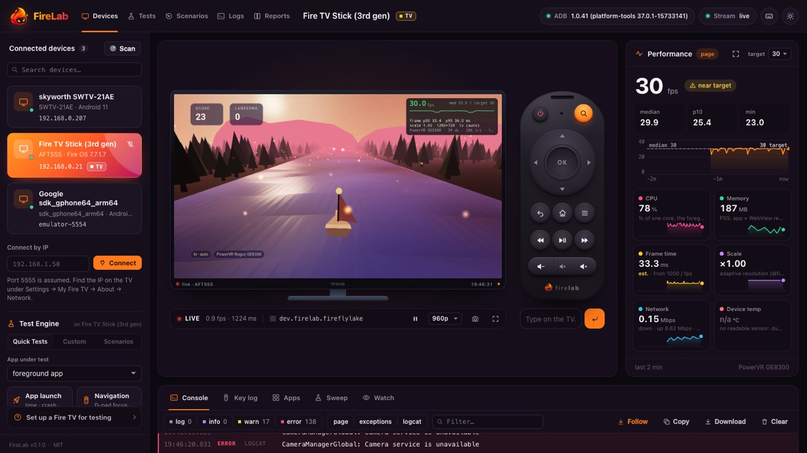
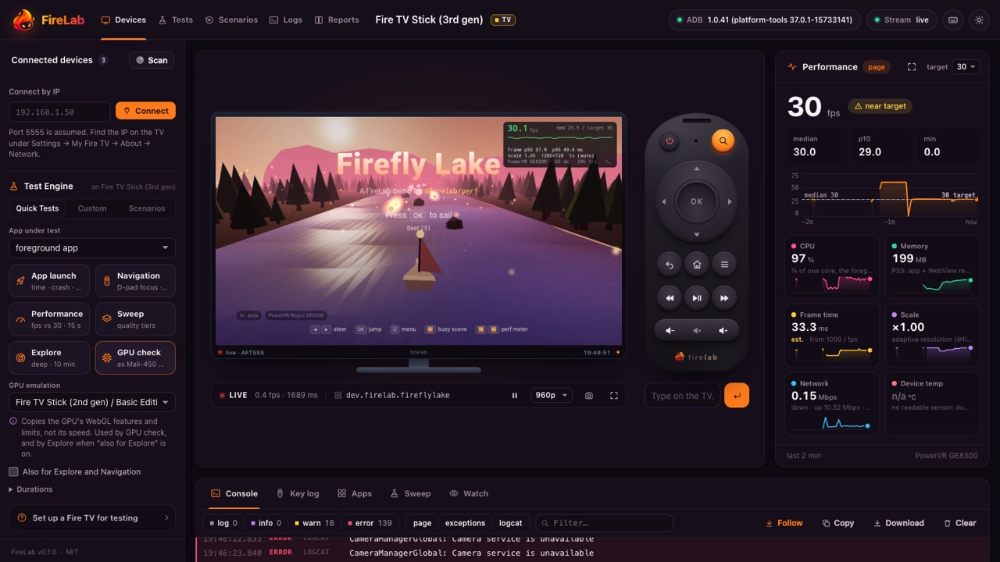
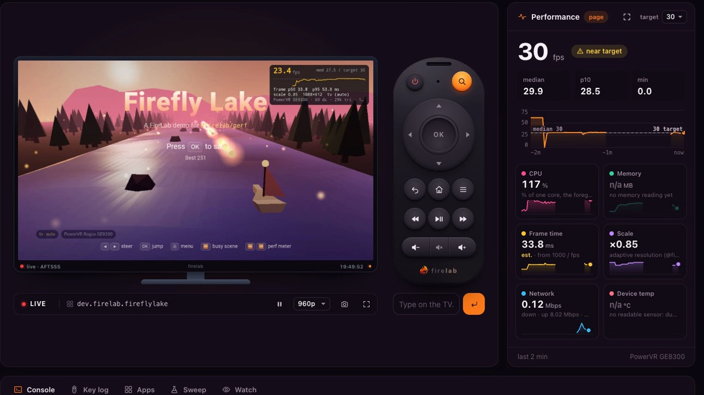
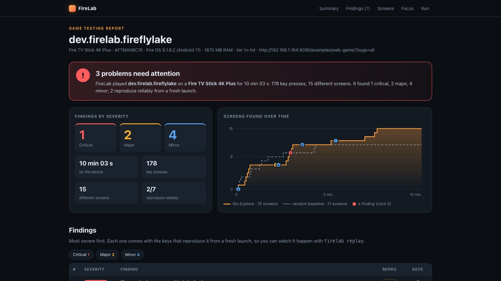
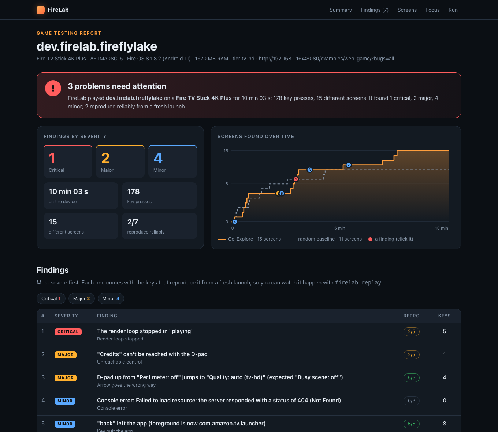
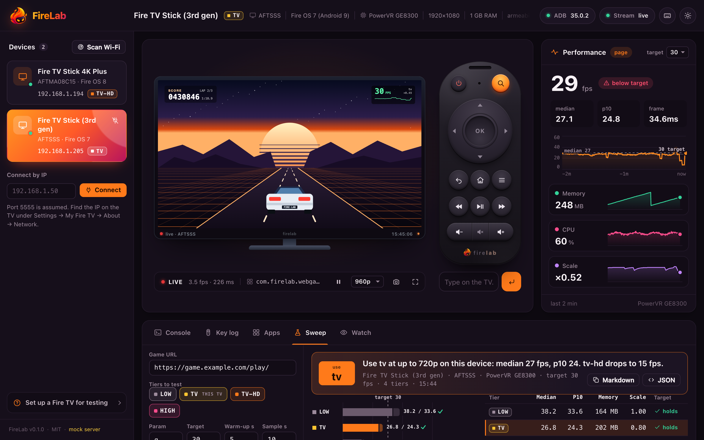

<p align="center"></p>

# FireLab

**Test your Fire TV game on every Fire TV, even if you don't own one.**

FireLab makes your game see any Fire TV model's GPU (its WebGL version,
texture limits and extensions) on a stick you already have, in an emulator, or
in desktop Chrome with no Fire TV at all. Then a game-testing engine plays the
game with the remote, finds crashes, black and frozen screens and D-pad focus
traps, and hands you each bug as the shortest key sequence that reproduces it,
with a measured reproduction rate. Free, local and MIT-licensed.

**[Website and videos](https://firelab-tv.vercel.app)** ·
**[Getting started](docs/GETTING-STARTED.md)** ·
**[Benchmark](docs/BENCHMARK.md)** ·
**[GPU emulation](docs/GPU.md)** ·
**[MCP tools](docs/TOOLS.md)**

## The problem

There are 66 Fire TV models in the wild, from the 1 GB Fire TV Stick with a
Mali-450 GPU and no WebGL2 to the 4K Max. A developer owns one of them, or
none. So the bugs that hurt TV games ship: a shader that compiles on your
stick but not on a Mali-450, a texture atlas bigger than the GPU allows, a
focus trap three menus deep, a black screen after a fast double press on OK,
a crash on the 1 GB stick. Testing it by hand means pressing the same remote
buttons for hours, on hardware you don't have.

## What FireLab does that hadn't been done for Fire TV

1. **Emulate any Fire TV's GPU, without that Fire TV.** Pick a model (the
   Fire TV Stick 2nd gen, the 4K Max, a Toshiba Fire TV, 60+ in all) and
   your game's WebGL reports only what that GPU supports: no WebGL2 on a
   Mali-450, its real `MAX_TEXTURE_SIZE`, its extension list, its shader
   precision. Calls the real GPU would refuse fail the same way, and
   FireLab lists them. It works on a real stick, in the emulator lab, or in
   desktop Chrome as a userscript, so a developer with **no Fire TV** can
   still find the "breaks on that stick" bugs. ([docs/GPU.md](docs/GPU.md))
2. **A game-testing engine built on the research, measured like the research.**
   `firelab explore` is Go-Explore adapted to a TV remote: an archive of
   screens, return-to-promising-states, fast double presses and long holds,
   a D-pad focus oracle that walks every screen's focus graph, and a
   minimiser (loop cutting, delta debugging) that turns a 37-key path into 8
   keys. It is benchmarked against uniform random input and Android's
   Monkey with the standard method for randomised testers (repeated runs,
   Mann-Whitney U, Vargha-Delaney Â12). We found no published exploration
   benchmark for TV or HTML5 games, so [we published one](docs/BENCHMARK.md).
3. **A go / no-go verdict for every Fire TV model from one stick.**
   `firelab fit` measures your game once and judges 66 models on memory,
   GPU features, video decoders and Android version, marking which verdicts
   are measured and which are estimates.
4. **Fire-TV-shaped emulators and CI.** `firelab lab` builds Android
   emulators with a model's RAM, heap, screen and Android version, and the
   GitHub Action can run smoke tests and the engine on every pull request.
5. **An AI agent can test the TV.** The MCP server gives Claude Code, Kiro,
   Cursor or VS Code 24 tools to see the screen, press the remote, read the
   WebView console, measure, and run the engine.

## See it working

All recordings are real: a Fire TV Stick (3rd gen, 1 GB, Fire OS 7) on our
desk, recorded on 19 Oct 2026. They play on the
**[website](https://firelab-tv.vercel.app)**; click a picture to open the
video file.

| | |
|---|---|
| [](site/assets/firefly-dash.webm) | [](site/assets/gpu-check.webm) |
| **Live dashboard on a real stick:** mirror, remote, 29.9 fps median (p10 25.4), CPU 78%, 187 MB. | **GPU check as a Fire TV Stick 2nd gen:** `getContext("webgl2")` refused on the Mali-450, on a 3rd gen stick pretending to be a 2nd gen. |
| [](site/assets/explore-dash.webm) | [](site/assets/engine-report.webm) |
| **`firelab explore` driving the remote** on the stick, while the dashboard watches. | **The report:** each finding with a screenshot, the shortest keys, the reproduction rate and a replay command. |

## Results

| What | Result | Evidence |
|---|---|---|
| Bugs reported, Firefly Lake (5 seeded) | FireLab **4**, Monkey 2, Random 1 (median of 5 × 10 min; Â12 = 1.00, p ≈ 0.01) | [benchmark](docs/results/benchmark-2026-10-18/) |
| Game code covered, Firefly Lake | FireLab **120** JS blocks, Monkey 79, Random 74 | [benchmark](docs/results/benchmark-2026-10-18/) |
| Screens reached, Deep Quest (30-floor RPG) | FireLab **246**, Random 82, Monkey 70; deepest 36 keys vs 13.5 | [benchmark](docs/results/benchmark-2026-10-18/) |
| A real bug on a real Fire TV | Back quit the app on busy pages: 37 keys shrunk to **8**, reproduced **5/5**, fixed and re-verified **0/5** | [friction log](docs/FRICTION-LOG-FIRELAB.md) |
| **No Fire TV at all:** explore in desktop Chrome as a Fire TV Stick 2nd gen | Found that Firefly Lake breaks on that stick: `getContext("webgl2")` refused on the Mali-450, `Error: WebGL2 not available`, render loop stopped | [report](docs/results/no-fire-tv-gpu-emulation-2026-10-19/) |
| GPU check on a real stick as a 2nd gen | WebGL2 refused on the Mali-450 | [result](docs/results/firetv-stick-3rd-gen-2026-10-19/gpu-check-as-AFTT.json) |
| Explore on a 1 GB Fire TV Stick (3rd gen) | 44 steps, 4 game states in 3 min at ~3 s per key | [report](docs/results/firetv-stick-3rd-gen-2026-10-19/) |
| Test suite | **830** automated tests passing (594 + 236 in `@firelab/perf`) | `npm test` |

The benchmark games and their bugs were written by FireLab's authors and five
runs is a laptop budget, so treat the p-values as indicative. The limits are in
[docs/BENCHMARK.md](docs/BENCHMARK.md).

## Built for the Amazon Developer Hackathon

FireLab was built during **Build, Ship, Shape: Amazon Developer Hackathon 2026**
and is entered in the **Open Source mini challenge**, alongside our Fire TV
track game, *Sunset Villa*, which FireLab was first built to test.

- **What we built in the hackathon window:** the engine, GPU emulation,
  `fit`, the emulator lab and GitHub Action, the dashboard, the MCP server,
  `wrap` and `@firelab/perf`.
- **Friction logs** in the rules' format (task, steps, expected vs actual,
  severity, workaround, suggestion): [FRICTION-LOG-FIRELAB.md](docs/FRICTION-LOG-FIRELAB.md)
  and [FRICTION-LOG.md](docs/FRICTION-LOG.md).
- **Research behind the engine:** [docs/RESEARCH.md](docs/RESEARCH.md) and
  the design in [docs/ENGINE.md](docs/ENGINE.md).

### Try it in 60 seconds, no Fire TV needed

```sh
git clone https://github.com/AkilSaji/firelab.git && cd firelab
npm install
npm run demo        # the engine plays a simulated TV game with 6 seeded bugs, then opens the report
```

It takes about 5 seconds and needs only Node 22+: no Fire TV, no adb, no Android
SDK. Or skip installing: [](https://codespaces.new/AkilSaji/firelab)
and run `npm run demo` there. `npm run demo:dashboard` shows the live dashboard
with a simulated TV.

**See a real report first:** [the report from a real Fire TV Stick 4K Plus](https://htmlpreview.github.io/?https://github.com/AkilSaji/firelab/blob/main/docs/sample-run/report.html)
(10 minutes on Firefly Lake with seeded bugs; also in [docs/sample-run/](docs/sample-run/)).

[](docs/sample-run/report.html)

With an AI assistant, connect FireLab ([step 3 below](#60-second-quick-start)) and
ask: *"Run FireLab's explore on the demo driver and explain what it found."*

> **New here? Start with [Getting started: test your app on a Fire TV](docs/GETTING-STARTED.md).**
> It takes you from a new TV to a bug report, in order: connect, install, watch,
> `explore`, performance, other models (`fit`), emulators and CI, and AI agents.

**Test and tune apps and games on real Fire TVs, with AI agents and with a
live dashboard.**

FireLab drives Amazon Fire TV (Fire OS) and other Android TV devices over
adb. You can use it three ways:

- **An MCP server**, so Claude Code, Kiro, Cursor or VS Code can see the TV,
  press the remote, read the WebView's console and measure frame rate.
- **A CLI**, for scripts and CI.
- **A dashboard**, for people.

It also finds the best quality tier for your web game on each device, and it
can record a person's play session.


- **Find and keep devices.** It scans the Wi-Fi for TVs with adb, connects
  to them, and reconnects by itself when a Stick drops off. It knows Fire TV
  models by name ("AFTMA08C15" is the *Fire TV Stick 4K Plus*), their Fire OS
  version, CPU ABI, RAM and GPU, and the quality tier that suits them.
- **Remote control.** D-pad, OK, back, home, media keys and text, sent in
  one batched call. Real holds (`right:1500`) go through a virtual HID remote
  that FireLab builds with Android's own `hid` tool, with no root and
  nothing to install.
- **Screenshots that just work.** FireLab strips the warning text that some
  Fire OS builds print before the PNG. Its fast path (raw framebuffer
  through the device's gzip) takes 1.1 s instead of 2.5 s per 1080p frame on
  a Fire TV Stick 4K Plus.
- **See inside WebViews.** It evaluates JS, captures console errors and
  exceptions, reloads or navigates the page, and counts frames. All of this
  goes through Chrome DevTools over `adb forward`, with no Chrome needed.
- **Frame rate you can trust.** FireLab reads
  [`window.firelab`](#the-perf-library) when the page publishes it. Without
  it, an injected probe counts frames that actually drew WebGL, so a game
  capped at 30 fps reads 30, not 60. On a real three.js game the probe was
  within about 1 fps of the game's own counter. For native and Unity apps,
  FireLab reads SurfaceFlinger frame timing. It also reports memory (app plus
  WebView renderer) and CPU.
- **The sweep.** It loads your game at every quality tier, measures it, and
  recommends the richest tier that holds 30 fps on *this* device, with a
  plain-English reason.
- **Watch a person play.** It records every remote press with its hold time,
  plus fps, memory, errors and a thumbnail every 10 s, and gives you a
  summary at the end.
- **Apps.** List, install (it checks the APK's ABI and minSdk before adb
  fails cryptically), launch with Android's own launch time, force-stop,
  reset (only with explicit confirmation), and logcat filtered by app.

MIT licensed. No telemetry. Tested on macOS; Linux and Windows are supported (adb discovery and paths are handled) but not yet tested on real hardware.

## 60-second quick start

**1. On the Fire TV:** go to Settings > My Fire TV > About and select the
device name 7 times. Then go to Developer options and turn **ADB debugging**
on. Note the IP address under About > Network.

**2. On your computer:** you need Node 22+ and adb (`brew install --cask
android-platform-tools`, `sudo apt install adb`, or
`winget install Google.PlatformTools`).

Install FireLab from this repository (it isn't on npm yet):

```sh
git clone https://github.com/AkilSaji/firelab.git
cd firelab && npm install && npm run build && npm link   # `firelab` now works in any folder
firelab connect 192.168.1.50     # then press "Allow" on the TV, tick "Always allow"
firelab doctor                   # checks everything, explains any fix
```

**3. Connect your AI assistant (MCP).** FireLab runs as an MCP server on your
own computer: the assistant starts it, and it talks to the TV over adb. Nothing
goes to a cloud service. Add it once:

<details open>
<summary><b>Claude Code</b></summary>

```sh
claude mcp add firelab -- firelab mcp
```

or in `.mcp.json` in your project:

```json
{ "mcpServers": { "firelab": { "command": "firelab", "args": ["mcp"] } } }
```
</details>

<details>
<summary><b>Claude Desktop</b>: Settings > Developer > Edit Config (<code>claude_desktop_config.json</code>)</summary>

```json
{ "mcpServers": { "firelab": { "command": "firelab", "args": ["mcp"] } } }
```

Claude Desktop may not see your shell's `PATH`: if it can't start `firelab`,
use the full paths, e.g. `"command": "/usr/local/bin/node", "args": ["/path/to/firelab/dist/cli.js", "mcp"]`.
</details>

<details>
<summary><b>Kiro</b>: <code>.kiro/settings/mcp.json</code></summary>

```json
{ "mcpServers": { "firelab": { "command": "firelab", "args": ["mcp"] } } }
```
</details>

<details>
<summary><b>Cursor</b>: <code>.cursor/mcp.json</code></summary>

```json
{ "mcpServers": { "firelab": { "command": "firelab", "args": ["mcp"] } } }
```
</details>

<details>
<summary><b>VS Code</b>: <code>.vscode/mcp.json</code></summary>

```json
{ "servers": { "firelab": { "type": "stdio", "command": "firelab", "args": ["mcp"] } } }
```
</details>

<details>
<summary><b>Without <code>npm link</code></b></summary>

Point the config at the built CLI directly:

```json
{ "mcpServers": { "firelab": { "command": "node", "args": ["/absolute/path/to/firelab/dist/cli.js", "mcp"] } } }
```
</details>

<details>
<summary><b>Any client over HTTP</b> (one server for several clients)</summary>

```sh
firelab mcp --http 7301      # Streamable HTTP at http://127.0.0.1:7301/mcp
```

Then give your client the URL `http://127.0.0.1:7301/mcp`, e.g.
`claude mcp add --transport http firelab http://127.0.0.1:7301/mcp`. It only
listens on this computer (127.0.0.1).
</details>

If adb isn't on your `PATH`, add `"env": { "ADB": "/path/to/adb" }` to the
server config. Restart the assistant after changing its config; then ask it
"list my Fire TV devices" to check the connection.

**4. Ask your assistant:**

> Find bugs in my game dev.example.mygame on the Fire TV: explore it for 15
> minutes, then tell me what broke, how to reproduce each problem, and what to fix.

> Take a screenshot of the TV, open my game com.example.game, play the first
> level with the remote, and tell me what looks wrong on a 10-foot screen.

> Run a performance sweep of http://192.168.1.20:8080/ and tell me which
> quality tier to ship for this device.

**More copy-paste prompts** (no Fire TV / emulator setup, fix-and-verify, web
games, native APKs, performance, every-model fit, CI) are in
[docs/PROMPTS.md](docs/PROMPTS.md). The `explore_app`, `playtest` and
`tune_performance` prompts walk an assistant through each. All 24 tools are listed in [docs/TOOLS.md](docs/TOOLS.md).
When FireLab is published on npm, `npx -y firelab mcp` will work without cloning.

### Quick start: TV performance

Add [`@firelab/perf`](packages/perf) to your web game:

```js
const perf = createPerf();
perf.attach(renderer);
// … in your frame loop:
perf.frame();
```

It detects the GPU and picks a tier (`low` / `tv` / `tv-hd` / `high`). It
holds 30 fps by adapting the render resolution, and shows a meter when you
add `?perf=1` to the URL. It also publishes `window.firelab`, which
`firelab sweep` reads. See
[packages/perf/README.md](packages/perf/README.md).

## The CLI

```sh
firelab devices --scan --connect        # find Fire TVs on the Wi-Fi and connect them
firelab info                            # model, Fire OS, ABI, RAM, GPU, tier, power, foreground app
firelab screenshot -o tv.png
firelab keys down*3 ok                  # also: ok:long, right:1500, back, home, playpause ...
firelab launch com.example.game
firelab eval "document.title" --package com.example.game
firelab measure --seconds 10            # fps median/p10, memory, CPU of the foreground app
firelab sweep --url http://192.168.1.20:8080/ --tiers low,tv,tv-hd,high
firelab watch --minutes 10              # record a play session (Ctrl-C to stop)
firelab logcat --package com.example.game --level warn
firelab ui                              # the dashboard
```

`-d <serial|ip>` picks a device when more than one is connected, and `--json`
gives machine-readable output. `firelab help` lists everything.

## The dashboard

`firelab ui` opens http://localhost:7300. It has:

- a live mirror of the TV screen
- a virtual remote (your keyboard works too, and holding a button holds it)
- live fps, memory and CPU charts
- the WebView console, mixed with the app's logcat errors
- an apps panel (launch, stop, reset, install an APK)
- the sweep runner
- recorded play sessions with their key timeline and thumbnails

Behind it is a small HTTP and SSE API (see
[docs/CONTRACT.md](docs/CONTRACT.md)), so you can script it too. The API
listens on localhost only and refuses cross-site requests.

## The sweep

Web games on TV need different settings per chip. A three.js scene that runs
at 60 fps on a laptop can drop to 13 fps on a 1 GB Fire TV Stick with
shadows on. `firelab sweep` (or the `performance_sweep` tool, or the
dashboard's Sweep tab) does the following:

1. Loads your page with `?q=low`, `?q=tv`, `?q=tv-hd` and `?q=high` in turn.
   The parameter name and the tiers can be changed.
2. Optionally presses keys or runs JS after each load, to reach a busy
   scene.
3. Warms up, then measures fps every second, plus memory and CPU.
4. Recommends the **richest tier that holds the target**: a median of at
   least 30 fps (within 5%, because frame-capped games jitter a vsync now
   and then) and a p10 of at least 24 fps, so it doesn't stutter.
5. Restores the page and saves JSON and Markdown to `~/.firelab/sweeps/`.



**Try it with the example game:** run `node examples/web-game/serve.mjs`,
open the address it prints on the TV, then run:

```sh
firelab sweep --package dev.firelab.fireflylake --url "http://<ip>:8080/examples/web-game/?autoplay=1"
```

<!-- SWEEP-RESULT:BEGIN -->
Result from a real run on a Fire TV Stick 4K Plus (AFTMA08C15, PowerVR
GE9215, Fire OS 8.1.8.2) with the three.js game *Sunset Villa*:

> **Pending.** The run is scheduled on the test device; it will be pasted
> here from `npm run device:check -- ... --sweep` (see
> [Tested on](#tested-on)). The table looks like this:
>
> | Tier | Median fps | p10 fps | Memory | Render scale | Holds target |
> |---|---:|---:|---:|---:|---|
> | tv | … | … | … MB | – | … |
> | **tv-hd** | … | … | … MB | – | … |
> | high | … | … | … MB | – | … |
>
> **Recommendation: `<tier>`.** `<tier>` is the richest tier that holds 30 fps
> here (median … / p10 … fps). `<next>` drops to median … / p10 … fps.
<!-- SWEEP-RESULT:END -->

Live numbers that FireLab has already measured on that device and game: 24.6–27.5 fps
(counted from frames that drew WebGL), 484 MB for the app plus its WebView
renderer, and about 135% of one CPU core while exploring. The probe agreed
with the game's own frame counter to within about 1 fps.

## The perf library

[`@firelab/perf`](packages/perf) is a tiny, dependency-free browser library
for TV web apps and games. It:

- detects the GPU and picks a tier
- holds your target fps with adaptive resolution
- shows an on-screen meter
- publishes `window.firelab`, so the tester reads the game's own numbers

```js
import { createPerf } from '@firelab/perf';
const perf = createPerf();                       // detect the GPU, pick a tier ('low' | 'tv' | 'tv-hd' | 'high')
perf.attach(renderer);                           // three.js: adaptive resolution drives setPixelRatio()
renderer.setAnimationLoop(() => { renderer.render(scene, camera); perf.frame(); });
```

There is a demo game in [examples/web-game](examples/web-game): *Firefly
Lake*, a small three.js game that uses @firelab/perf end to end. Run it with
`node examples/web-game/serve.mjs`.

## `firelab wrap`

`firelab wrap` turns any URL into a Fire TV / Android TV APK, without Gradle:

```sh
firelab wrap --url http://192.168.1.20:8080/ --name "My Game" [--install <device>]
```

It needs Android build-tools and a platform
(`sdkmanager "build-tools;35.0.0" "platforms;android-35"`) plus JDK 17. Run
`firelab wrap --check` to see what's missing (`firelab doctor` checks it
too). In the APK, remote keys arrive as keyboard events. Back sends Escape,
so call `preventDefault()` on it to handle it yourself. See
[android-template/README.md](android-template/README.md).

## Game testing engine

`firelab explore` plays your TV app with the remote, on its own, and hunts for
**crashes and ANRs, JS exceptions, black screens, frozen pictures or a stopped
render loop, D-pad focus traps, controls the D-pad can't reach, and arrow keys
that ignore the layout**. Every finding comes back shrunk to the shortest key
sequence that reproduces it, with a measured reproduction rate, in one
self-contained `report.html` (plus `report.md` for PRs).

```sh
firelab explore --package dev.firelab.fireflylake --minutes 10
firelab explore --apk my-game.apk --minutes 10 --fail-on crash,black,frozen,focus-trap --out out/ --json
firelab replay out/traces/f-2aa559.min.trace.json --times 5    # reproduced k/n from a fresh launch
firelab shrink out:f-2aa559 --budget-min 10                     # shrink (again) later
firelab report out --baseline <random-run-dir>                  # rebuild the report, with a baseline curve
```

No TV? Any web game runs in headless Chrome at the Fire TV WebView's viewport,
with remote keys delivered the way FireLab's TV wrapper delivers them:

```sh
firelab explore --driver browser --url https://my-game.example/ --minutes 10 --coverage
```

How it works (details in [docs/ENGINE.md](docs/ENGINE.md)):

- **Go-Explore on a TV.** It keeps an archive of the screens it has seen, picks
  a promising one, gets back to it (over the key graph it has learned, or by
  relaunching and replaying the shortest known path: a TV has no snapshots),
  then tries every remote key there, plus fast repeats (`ok×3`) and long presses.
- **Deep by design.** On every new screen it reads the focusable controls and
  presses each one in turn, so a button opens a dialog, the dialog's buttons are
  next, and so on 100+ presses down. Cells with untried keys and deep cells are
  preferred, productive episodes run longer, keys that do nothing are learned
  per screen, and with `--coverage` a press that runs new JavaScript counts as
  progress (V8 block coverage). Each idea comes from published GUI-testing work
  (DroidBot, APE, Stoat, TimeMachine, Go-Explore, Wuji): see ENGINE.md 6.7.
- **States come from inside the app**: one Chrome DevTools probe per step reads
  the URL, `window.firelab` marks, the focused element and an optional
  `--state-expr` (e.g. `demo.ui`). Canvas apps with no probe fall back to a
  visual hash of the screen.
- **Oracles**: *health* (logcat crashes/ANRs/renderer death, unexpected exits,
  JS exceptions), *screen* (black, frozen, render loop stopped, WebGL context
  lost), *focus* (on each new screen it walks the D-pad focus graph and checks
  it against the layout: traps, unreachable controls, non-spatial moves, lost
  focus), and *stuck* (dead ends).
- **Shrinking**: the explorer's own shortcuts first, then loop cutting, delta
  debugging and gap shrinking, accepting a candidate when it reproduces in
  replays; then 5 replays decide *confirmed* (≥ 60 %), *flaky* or *not reproduced*.
- **CI**: `--fail-on` takes `crash`, `black`, `frozen`, `focus-trap`, `js`,
  `unreachable`, `non-spatial`, `focus`, `exit`, a severity or a finding kind
  (default `critical,major`). Exit code 1 when a matching finding didn't fail
  to reproduce. `--json` prints a summary; `report.md` fits a job summary.
  `--url` is the page a wrapped web app opens (it needs `--package` or `--apk`
  too; wrap a bare URL first with `firelab wrap`).
- **MCP**: `explore_start`, `explore_status` (with the current screen as an
  image), `explore_stop`, `explore_findings`, and an `explore_app` prompt.
- **Vega OS**: `--driver vda` on `explore`, `replay` and `shrink` (MCP:
  `driver: "vda"`) drives a Vega Fire TV through the Vega SDK's `vega` CLI;
  `--apk` then takes a `.vpkg`. Vega has no JS eval, so states come from the
  screen and the focus oracle is off, and FireLab sees the app go only when its
  process ends; the report notes all of this. **The Vega driver has not run on
  a real Vega device or the Vega Virtual Device yet**: see [docs/VEGA.md](docs/VEGA.md).
- **It learns from everyone who uses it.** `firelab learn export` turns your
  runs into a small knowledge pack: the last keys of each confirmed bug (e.g.
  `ok*3 -> black-screen`) and which keys tend to matter. Contribute it with a
  pull request to [knowledge/](knowledge/README.md) and every FireLab run tries
  those patterns early on new screens. It works the same from the CLI, an AI
  assistant (MCP `learn_export`) or CI. Opt-in, reviewed, no URLs, names, text
  or screenshots, and nothing is ever uploaded automatically.
- **Benchmark**: `firelab bench` runs FireLab, an ablation of its first
  version, uniform Random and Android Monkey's D-pad event mix on games with
  seeded bugs (Firefly Lake, and Deep Quest: a TV RPG with a 30-floor dungeon
  whose bugs sit from 9 to 100 presses deep), scored on ground truth the games
  record themselves plus JS coverage, with Mann-Whitney U, Vargha-Delaney Â12
  and Fisher's exact test. See [docs/BENCHMARK.md](docs/BENCHMARK.md).
- It refuses to drive `com.sunsetvilla.tv` (someone's real progress) unless you
  pass `--allow-package`.

**Measured** on a Fire TV Stick 4K Plus (Fire OS 8), Firefly Lake with
`?bugs=all` (5 seeded bugs in [examples/web-game/bugs.js](examples/web-game/bugs.js)),
seed 1, 10 minutes each:

| | Go-Explore | random baseline |
|---|---|---|
| steps (≈ 2.8 s each: one `input keyevent` ≈ 1.2 s, one frame grab ≈ 1.8 s) | 178 | 166 |
| distinct states | 15 | 11 |
| seeded bugs found | 2 of 5: **freeze** (render loop stopped after the 2nd lantern), **grid** (unreachable "Credits" + list-order arrows) | 1 of 5: **freeze** |
| other findings | Back exits the app when the page is busy, even though the page handled it (a race in FireLab's own wrapper, now fixed; see below) | the same Back race (4 findings: random presses Back often) |
| shortest repros | `menu playpause ok down up` (freeze, flaky 2/5: rock spawns are random), `menu` (Credits, 2/5), `menu up up up` (non-spatial, 5/5), `menu up up up left right up back` (Back race, 5/5, from 37 keys) | (not shrunk) |

One run per strategy, so treat the comparison as preliminary (ENGINE.md 12.3).
Missed in the Go-Explore run: **black** (needs `ok×3` on Resume; the run sent one macro
in 178 steps, and `firelab replay` of `menu ok×3` does blank the screen 2/2),
**throw** (needs ▶ then ◀ on Quality) and **trap** (the focus walk saw the
trapped group, but Back left the app instead of doing nothing, because of the
wrapper race, since fixed). On a simulated version of the same game (`test/engine/`), with
10 minutes of simulated device time, the explorer finds all 6 seeded bugs and
shrinks five to at most 6 keys; the random baseline finds 3 and never the
focus trap, the unreachable control or the black screen. Real TVs are slow:
expect a few hundred steps per 10 minutes, and give exploration 30+ minutes
for deep bugs.

**The engine found a real bug in FireLab itself.** In wrapped web apps
(`firelab wrap`), Back sometimes quit the app even when the game had handled it:
the wrapper recorded "the page used Back" in an async callback that could run
after the key-up check when the page was busy. The engine shrank a 37-key random
path to 8 keys (`menu up up up left right up back`) that reproduced it 5/5 on
the Fire TV Stick 4K Plus, and 2/3 with the seeded bugs off. Fixed in
`android-template` (the flag is now set inside the key-down script). Verified
with `firelab replay` on a real **Fire TV Stick 3rd gen**: the old wrapper quits
2/5 (seeded bugs on) and 2/3 (off), the fixed one 0/5 and 0/5. On an
AFTSSS-shaped emulator: old 4/5, fixed 0/5 and 0/5; Back on the title screen
still exits. Rebuild wrapped apps with `firelab wrap` to get the fix.

### Real games on a real Fire TV

On 2026-10-18 FireLab explored **11 shipped party games** (a games hub and ten
games from one studio) on a **Fire TV Stick 3rd gen** (AFTSSS, 1 GB,
Fire OS 7.7.1.7): 8–10 minutes each, about 1,000 key presses in total. None of
these builds allow WebView inspection, so FireLab tested them from the outside:
crashes, ANRs, black and frozen screens, keys that quit the app, and D-pad focus
where Android exposes it.

| Game | What FireLab found | Repro |
|---|---|---|
| Game A | **Crash on Back**: `NullPointerException` while the activity is destroyed | 1 key (`back`), **5/5** |
| Game B | **Crash on launch**: `java.net.BindException: Address already in use` | **5/5** |
| Game C | **Same crash on launch** | **4/5** |
| Games D–J and the games hub | No crashes, ANRs, black or frozen screens | |

The two launch crashes have one cause: each party game opens its own "play on
your phone" web server on a fixed port (8765). With another party game still
running in the background, as Fire OS leaves it after Home, the next one can't
bind the port and crashes. FireLab confirmed it by launching each game alone
(works) and after another game (crashes).

These runs also made FireLab better. Exploring games that can't be inspected
showed four sources of false findings: frozen-screen alarms when a dialog
pauses the background, "Back left the app" on a game's first screen, a games
hub opening a game, and "unreachable" buttons in a game that draws its own
highlight. All four were fixed the same day, with tests, and the re-runs came
back clean. Details are in [docs/FRICTION-LOG.md](docs/FRICTION-LOG.md),
entries 12 and 13.

## No Fire TV? Use the lab

`firelab lab` makes an Android emulator shaped like a real Fire TV model: the
same Android API level as its Fire OS, the same RAM and heap, and the same
screen and density. Every FireLab command then works on it as if it were a TV.

```sh
firelab lab doctor                              # SDK, emulator, KVM/HVF, system images (prints install commands)
firelab lab create --profile AFTSSS --install   # Fire TV Stick (3rd gen): Android 9, 1 GB, 1080p
firelab lab start --headless                    # boots it and connects it like a device
firelab lab smoke --apk my-app.apk              # install, launch, screenshot, no crash/ANR, memory vs the stick's budget
firelab explore --apk my-app.apk                # the game-testing engine works here too
firelab lab stop
```

In CI, the [FireLab lab action](action/action.yml) does all of this on
GitHub's `ubuntu-latest` (it has KVM), uploads the HTML report and writes a
job summary:

```yaml
- uses: AkilSaji/firelab/action@v0
  with:
    apk: app/build/outputs/apk/debug/app-debug.apk   # or url: https://my-game.example/
    profile: AFTSSS
```

The emulator matches a Fire TV's memory, screen and API level, **not** its
Mali/PowerVR GPU, ARM CPU or Amazon WebView, so its frame rates mean nothing
for a real stick: use `firelab fit` with the real profiles for performance.
See [docs/LAB.md](docs/LAB.md).

What the lab can copy of the GPU is its **features and limits**, which are
exact per chip: `--emulate-gpu <model>` makes WebGL report only what that
model's GPU has (WebGL2 or not, `MAX_TEXTURE_SIZE`, extensions, ASTC/ETC/S3TC,
shader precision, the renderer string) and lists the WebGL calls that fail, so
you see where a web game breaks on a stick without the stick. It copies
features, not speed. It works on the lab, a real device or desktop Chrome:

```sh
firelab fit --emulate-gpu AFTT --url http://10.0.2.2:8080/ -p dev.firelab.mygame   # failed WebGL calls on a Mali-450 stick
firelab explore -p dev.firelab.mygame --emulate-gpu AFTT                           # the engine plays it; each failure is a finding
firelab fit --emulate-gpu AFTSSS --script gpu-AFTSSS.js                            # the shim for desktop Chrome
```

See [docs/GPU.md](docs/GPU.md).

## How it works

```
 Claude Code / Kiro / Cursor / VS Code        you, in a browser          scripts / CI
            │ MCP (stdio or HTTP)                  │ HTTP + SSE                │
            ▼                                      ▼                           ▼
   src/mcp (24 tools, 3 prompts)          src/http (dashboard API)       src/cli.ts
            └────────────────────┬─────────────────┴───────────────────────────┘
                                 ▼
                       src/core FireLab  (devices, sessions, jobs)
          ┌──────────────────────┼─────────────────────────────┐
          ▼                      ▼                             ▼
  src/adb: adb client      src/cdp: DevTools over         src/perf: meminfo, /proc,
  discovery, reconnect,    adb forward: eval, console,    SurfaceFlinger, measure,
  keys + HID remote,       navigate, fps probe            sweep, watch sessions
  screenshots, apps, logs                                 (tiers: @firelab/perf/chips)
          └──────────────────────┴─────────────────────────────┘
                                 ▼
                    adb ──Wi-Fi/USB──▶ Fire TV / Android TV
```

Everything that parses device output is tested against output recorded from
real devices (`test/fixtures/`). The MCP tools (over stdio-style in-memory and
Streamable HTTP transports), the HTTP API, the DevTools client (against a fake
DevTools server), the virtual remote and the sweep logic all have tests that
need no device; the game-testing engine runs against a simulated TV game.
`npm test` runs 553 Vitest tests plus 236 node:test tests for `@firelab/perf`.

## Tested on

| Device | Model | OS | GPU | Status |
|---|---|---|---|---|
| Fire TV Stick 4K Plus (2025) | AFTMA08C15 | Fire OS 8.1.8.2 (Android 11) | PowerVR GE9215 | **Verified 2026-10-15/16.** Device detection and info, doctor, apps, screenshots (raw+gzip 1.1–2 s, PNG 2.5 s), WebView eval, the fps probe against the game's own counter, logcat, keys (`input keyevent`; no HID holds on Fire OS 8), launch/stop, `wrap --install`, the stdio MCP server, the dashboard with its live stream, and the game-testing engine (explore, replay, shrink: about 2.8 s per step). **Pending on a real TV:** sweep and watch (both verified end to end on an AFTSSS-shaped emulator, 2026-10-18). |
| Fire TV Stick (3rd gen) | AFTSSS | Fire OS 7.7.1.7 (Android 9) | PowerVR GE8300 | **Verified 2026-10-18.** Connect, info, screenshots, keys, launch/stop, `wrap --install`, `sweep` (tv holds 30 fps), `replay` (Back fix: old wrapper 2/5 and 2/3, fixed 0/5 and 0/5), the dashboard, and `explore` on 11 real games (above). **Pending on a real TV:** `watch`. |

The computer was macOS 26 (Apple silicon), Node 24.20 and adb 1.0.41
(platform-tools 37.0.1). To add your device, run
`npm run device:check -- --device <ip> [--package <webview app> --url <page> --sweep --keys]`
and send its "tested on" row in a PR. Even more useful: record your model's
profile with `firelab profile -d <ip>` and send `profiles/<MODEL>.json`
([how](profiles/README.md)). Only 2 of the 66 Fire TV models have one so far.

## Safety and privacy

- FireLab never connects to a device on its own: scans only report what they
  find. Its adb probe never triggers a prompt on someone else's TV.
- Tools that change things say so. `reset_app` (clear data) requires
  `confirm: true`, and `install_app` and `stop_app` are marked destructive
  for agents.
- The dashboard and MCP HTTP servers bind to 127.0.0.1 and refuse foreign
  Host headers and cross-origin writes.
- Nothing is sent anywhere: there is no telemetry and no cloud.
  Screenshots, sweeps and sessions stay in `~/.firelab`.

## Docs

- [docs/GETTING-STARTED.md](docs/GETTING-STARTED.md): the step-by-step
  journey, and what each check finds for native and web apps.
- [docs/TOOLS.md](docs/TOOLS.md): every MCP tool and prompt.
- [docs/PROMPTS.md](docs/PROMPTS.md): copy-paste prompts for AI assistants.
- [docs/TROUBLESHOOTING.md](docs/TROUBLESHOOTING.md): unauthorized devices,
  Wi-Fi drops, WebView debugging, the screensaver, frame-rate questions.
- [docs/CONTRACT.md](docs/CONTRACT.md): the HTTP API, SSE events, the
  `window.firelab` hook and the tier vocabulary.
- [docs/FRICTION-LOG.md](docs/FRICTION-LOG.md) and
  [docs/FRICTION-LOG-FIRELAB.md](docs/FRICTION-LOG-FIRELAB.md): what got in the
  way building on Fire TV, and using FireLab itself, with what we fixed.
- [docs/BENCHMARK.md](docs/BENCHMARK.md): `firelab bench`, the engine against
  Random and Monkey on games with seeded bugs, with the latest results.
- [docs/GPU.md](docs/GPU.md): GPU capability emulation for web games
  (`--emulate-gpu`): WebGL features and limits per model, not speed.
- [docs/VEGA.md](docs/VEGA.md): the Vega OS driver (Fire TV Stick 4K Select and
  newer). Built from Amazon's docs, not yet tested on a real Vega device.
- [CONTRIBUTING.md](CONTRIBUTING.md): how to add fixtures and devices.

## License

MIT © the FireLab authors
