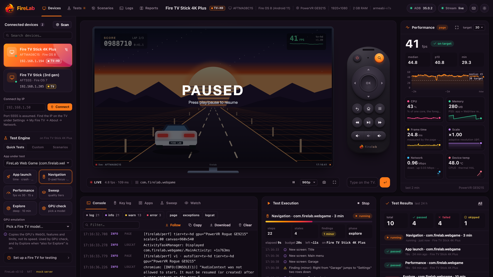

# FireLab dashboard (`ui/`)

The dashboard that `firelab ui` serves on http://localhost:7300. Five pages:

- **Devices**: connected TVs (with search) and the **Test Engine** in the left
  rail; a live mirror of the TV, a virtual remote and the mirror bar in the
  middle; the **Performance Monitor** on the right (fps with its chart, CPU,
  memory, frame time, render scale, network, device temperature); and along the
  bottom the tools dock (Console, Key log, Apps, Sweep, Watch), **Test
  Execution** (the running job) and **Test Results** (last 24 h).
- **Tests**: every engine run on this computer, with findings by severity,
  pass/fail, the report and Re-run; plus the history of test jobs.
- **Scenarios**: finding traces and watch sessions as key sequences, each with
  Replay and the last replay's result.
- **Logs**: the console full width, with level/source filters, search, follow,
  copy, clear and Download (`.log`).
- **Reports**: engine reports and benchmark reports (`~/.firelab/bench`).

Every number is measured on the device. What FireLab can't read shows as
`n/a` with the reason (hover the tile); estimates say `est.` (frame time is
`1000 / fps` unless the page publishes `window.firelab.frameMs`).

It is plain HTML, CSS and ES modules: no build step, no framework, no CDN, no
fonts to download. It ships inside the npm package and works offline. Charts are
drawn by hand on `<canvas>`.



## Develop against the mock server

You don't need adb or a TV. The mock implements the whole dashboard API from
[`docs/CONTRACT.md`](../docs/CONTRACT.md) with believable data:

```sh
node ui/dev/mock-server.mjs                      # http://localhost:7310
node ui/dev/mock-server.mjs --scenario empty     # no devices yet; "Scan Wi-Fi" finds three
node ui/dev/mock-server.mjs --scenario no-adb    # adb isn't installed
node ui/dev/mock-server.mjs --scenario trouble   # one offline TV, one waiting for "Allow USB debugging?"
node ui/dev/mock-server.mjs --port 7400
```

Edit any file in `ui/` and reload the page. The mock serves files with
`cache-control: no-store`.

What the mock fakes:

- **Two devices.** A Fire TV Stick 4K Plus at `192.168.1.194:5555`
  (AFTMA08C15, Fire OS 8, PowerVR GE9215, tier `tv-hd`, about 45 fps in the game)
  and a Fire TV Stick (3rd gen) at `192.168.1.205:5555` (AFTSSS, Fire OS 7,
  PowerVR GE8300, tier `tv`, about 27 fps). Scanning also finds `192.168.1.77`,
  which stays `unauthorized`.
- **A screen that reacts to the remote.** `screen.jpg` returns SVG frames from
  `dev/scenes.mjs`: a TV launcher where the D-pad moves the focus and OK opens
  an app, and a small racing game where left/right change lanes and play/pause
  pauses. Volume, menu, search and typed text show overlays.
- **SSE streams.** `perf` (twice a second, `page` source in the game and
  `native` on the launcher), `log` (console, exceptions and logcat lines),
  `key` (a person on the physical remote now and then, and constantly during a
  watch session) and `state`. On connect, it first replays the last two minutes
  so charts aren't empty.
- **Sweeps** that take about 10 s and reload the game at each tier. On the 3rd
  gen, `tv` holds 27/24 fps and `tv-hd` drops to 13–17; on the 4K Max, `tv-hd`
  holds 41/33.
- **Watch sessions**, with two finished ones already listed and thumbnails
  served from `/api/sessions/:id/thumbs/:n.jpg` (a mock-only route).
- **Test engine** (`dev/mock-tests.mjs`). Quick tests play out in seconds
  (a "3 min" navigation run takes about 20 s, explore about 40 s) with live
  steps, counters and findings, and move the mock TV while they run. Five
  engine runs (one GPU-emulated, one random baseline, one demo), their finding
  traces, ten test jobs over the last day, two benchmark reports, mock
  `report.html` pages, a slice of the Fire TV model table for the GPU picker,
  and vitals (Wi-Fi throughput, a SoC that warms up in the game; the first
  reading has no rate, like the real sampler). Perf samples from the game carry
  `frameMs`, the launcher's don't.
- **Mock-only switch.** `POST /__mock/scenario {"name":"empty"}` resets to a
  scenario without restarting.

## Layout

```
ui/
  index.html          page skeleton: top bar + page nav, devices rail + Test Engine, stage (TV + remote),
                      performance tiles, bottom row (dock, Test Execution, Test Results), and the
                      Tests, Scenarios, Logs and Reports pages
  logo.png            the FireLab logo (also favicon.png and apple-touch-icon.png)
  css/
    tokens.css        design tokens: colours, type, sizes; dark default, light via the toggle
    base.css          reset, buttons, inputs, chips, tooltips, callouts, focus, reduced motion
    app.css           layout: top bar, rail, stage and TV, mirror bar, performance panel, dock, toasts, dialogs
    remote.css        the virtual remote (D-pad ring, blue OK key, round buttons, hold feedback)
    panes.css         console, key log, apps + eval, sweep, watch
    pages.css         page nav and pages, Test Engine card, performance tiles, Test Execution,
                      Test Results, run tables, scenario and report cards
  js/
    main.js           entry: wires every module, dialogs, global shortcuts (? and f)
    store.js          shared state + a tiny event bus (devices, select, perf, log, key, state, keysent, tab…)
    api.js            fetch wrapper with readable errors, SSE subscribe()
    dom.js            h() element builder (text only via textContent), icon(), copy, localStorage helpers
    icons.js          the icon set: hand-drawn 24px stroke icons injected as an SVG sprite
    theme.js          theme toggle (dark by default, remembers light), cssVar()
    format.js         time/number formatting, tier vocabulary, key glyphs
    devices.js        rail: list, select, connect/disconnect, Scan Wi-Fi, connect by IP, recent devices,
                      health (adb + server) and the top-bar device summary
    stream.js         one EventSource per selected device; drops events it has already seen
    screen.js         live mirror: adaptive 2–5 fps polling, pause when hidden, "no signal" states,
                      screenshot download, full screen, key flashes
    remote.js         remote buttons with press-and-hold (holdMs), keyboard control, text box, Wake
    perf.js           performance readouts, the fps chart and six tiles (CPU, memory, frame time,
                      scale, network, temperature) from `perf` and `vitals` events
    pages.js          page router (#page=tests), page device pickers, moves the console to Logs
    engine.js         Test Engine card: quick tests, GPU emulation picker, custom explore, scenarios
    testkit.js        startTest(), status/severity chips, key sequences, report links
    exec.js           Test Execution: follows the job started last (SSE, else polling; sweeps too)
    results.js        Test Results: 24 h totals and recent runs
    tests-page.js     Tests page: engine runs (expand for findings + replay, re-run) and test jobs
    library.js        Scenarios page (traces, watch sessions, replay) and Reports page
    charts.js         LineChart (time series) and SweepChart (bars per tier), canvas 2D, HiDPI, theme-aware
    console.js        console: level/source filters, search, follow, copy, download, clear
    timeline.js       key log pane: 60 s two-lane timeline + list, copy as keys, replay
    apps.js           apps pane: launch (with URL), stop, reset with confirmation, install, WebView eval
    sweep.js          sweep pane: form, job progress (SSE, falls back to polling), result, copy MD/JSON
    watch.js          watch pane: start/stop, live counters, sessions with thumbnails, lightbox
    dock.js           tabs (ARIA tabs, arrow keys, #tab=sweep deep links)
  dev/
    mock-server.mjs   the mock API + static server (Node built-ins only)
    mock-tests.mjs    the mock test engine: tests, runs, scenarios, reports, GPU models, vitals
    scenes.mjs        SVG frames for the mock screen
    screenshots.mjs   regenerates docs/img/*.png with headless Chrome
```

Modules talk through `store.js`: `devices.js` owns the device list and the
selection, `stream.js` turns the selected device's SSE stream into bus events,
and every panel subscribes to what it shows. Nothing writes HTML from data;
log lines, package names and eval results go in as text.

## Using it

- **Test Engine.** Pick the app under test (or leave "foreground app"; the
  home screen is never tested). *App launch* runs lab smoke (launch time,
  still running, screen, memory against the model's budget, crash/ANR);
  *Navigation* is a short engine run hunting D-pad focus problems;
  *Performance* measures fps against the target; *Sweep* runs the Sweep tab's
  form; *Explore* is the full engine; *GPU check* reloads the app with WebGL
  limited to the picked model's GPU (features and limits, not speed; tick
  "also for Explore" to use it there too). *Custom* has every explore option,
  including a demo game that needs no TV. Test Execution follows the job and
  can stop it; finished jobs land in Test Results and on the Tests page.
- **Devices.** Pick a TV in the left rail (the selected one is the bright card). *Scan Wi-Fi* looks for adb on port
  5555; *Connect by IP* takes `192.168.1.50` (port 5555 assumed) or `ip:port`.
  Offline and unauthorized TVs show what to do next. Recently used TVs stay
  listed with a Connect button.
- **Screen.** Click the screen (or press `f`) and your keyboard drives the TV:
  arrows, Enter = OK, Esc/Backspace = Back, H = Home, M = Menu, Space =
  play/pause, `,` `.` = rewind/fast-forward, `+` `−` `0` = volume/mute, `/` =
  search, W = wake. Hold a key or a remote button for a long press. `?` lists
  every shortcut.
- **Performance.** fps against a target (30 by default), with the 2-minute
  median and p10, frame time, render scale, memory and CPU. The badge says where
  the numbers come from: `page` (`window.firelab` from `@firelab/perf`), `raf`
  (counting frames in the WebView) or `native` (Android frame stats).
- **Sweep.** Give it your game's URL. It loads `?q=low`, `?q=tv`, `?q=tv-hd` and
  `?q=high`, samples each one, and recommends the richest tier that holds your
  target. *Markdown* copies a table you can paste into an issue.
- **Watch.** Start, hand the remote to a player, stop. Each session keeps key
  presses, fps median/p10, peak memory, errors and a thumbnail strip.

## Screenshots

```sh
node ui/dev/screenshots.mjs           # docs/img/*.png at 2x, using its own mock on :7319
node ui/dev/screenshots.mjs --dpr 1   # smaller files
node ui/dev/screenshots.mjs --only dashboard-light.png --out /tmp/shots
```

It launches its own headless Chrome (set `CHROME_PATH` if it isn't in the usual
place) and reads the DevTools port Chrome picked. It never attaches to a fixed
port, because on a dev machine one of those can be an `adb forward` to a real
TV's WebView.

## Conventions

- Colours, sizes and fonts come from the tokens in `css/tokens.css`. The TV
  bezel stays black in both themes; the remote follows the theme. Status colours (ok/warn/bad)
  always come with a word or an icon.
- Every interactive element is a real `<button>`/`<input>` with a label, and
  keyboard focus is always visible. `prefers-reduced-motion` turns animation off.
- Layout targets laptops: 1280–1920 wide, usable down to phones. From 1600 the
  Devices page fits one screen with dock, Test Execution and Test Results side
  by side; below that the bottom row stacks and the page scrolls. Below 1280 the
  performance panel becomes a strip under the TV, below 1100 the page nav shows
  icons only, and below 820 everything is one column. The dock panes follow the width of the dock (container queries).
- Per-viewer preferences (theme, page, tab, mirror quality, target fps, sweep
  form, Test Engine options, eval history, recent devices) live in
  `localStorage` under `firelab.*`.
